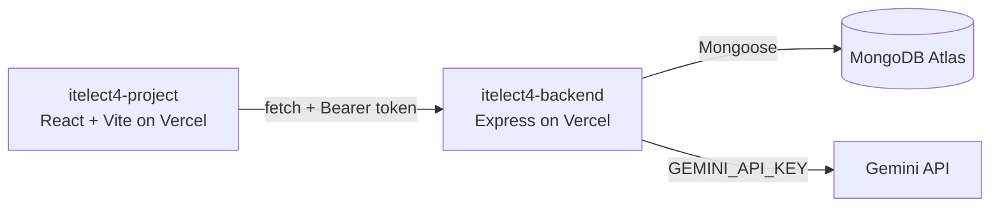

# ITELECT4 RSVP Tracker API

[](https://github.com/zirishbelo/itelect4-backend/actions/workflows/ci.yml)

Express and TypeScript API for the ITELECT4 RSVP Tracker. It authenticates users with JWT, serves event records, protects RSVP records by their authenticated owner, and provides an RSVP system review route.

- **Live API:** https://itelect4-backend-ivory.vercel.app/api/health
- **Live app:** https://itelect4-project-neon.vercel.app
- **Frontend repository:** https://github.com/zirishbelo/itelect4-project

## Architecture



## Local development

```bash
npm install
copy .env.example .env
# Fill in MONGODB_URI, JWT_SECRET, CORS_ORIGIN, PORT, and GEMINI_API_KEY
npm run dev
```

Useful checks:

```bash
npm run typecheck
npm test
npm run build
```

The test suite mocks the database connection and rejects short AI-review input before Gemini is called, so tests do not require MongoDB or a Gemini request.

## AI-use disclosure

The `/api/ai` route uses Gemini to review descriptions of the student, event, and RSVP flow.
